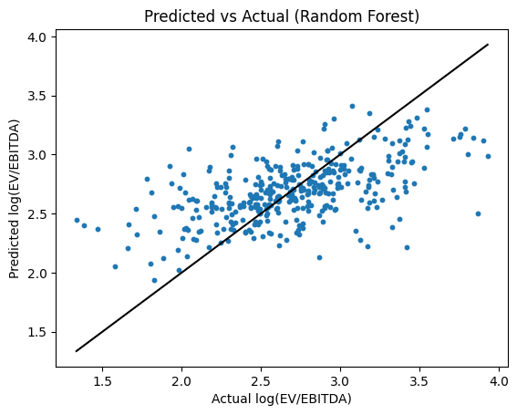

# S&P 500 Machine Learning Valuation Project

## Overview
A Python machine learning project that estimates the EV/EBITDA multiple an S&P 500 company “should” trade on, based on selected metrics. Companies valued well below their predicted multiple are noted as potentially undervalued, and become candidates for further analysis such as a DCF. A random forest model is used for the main analysis and is compared against other models to assess performance.

 

## Results
- Four different methods were used to create estimates: simply using the median value, using the sector median value, using a Ridge model, and using the Random Forest model. The results from each are shown below:

| Method | Median prediction error | R² |
|---|---|---|
| Same multiple for every company | 26.2% | 0.00 |
| Sector median multiple | 28.6% | 0.09 |
| Ridge regression | 25.2% | 0.05 |
| **Random forest** | **21.3%** | **0.33** |

- For the Random Forest model, this is an additional graph showing the predictions against the actual values

 

 - According to the model, these were the companies which are **most undervalued**:

| Ticker | Sector | Actual EV/EBITDA | Predicted EV/EBITDA | Log gap |
|---|---|---|---|---|
| EXE | Energy | 3.81 | 11.57 | 1.11 |
| APA | Energy | 4.00 | 11.04 | 1.02 |
| CF | Materials | 5.93 | 16.34 | 1.01 |
| FOXA | Communication Services | 7.75 | 21.19 | 1.01 |
| MOS | Materials | 6.87 | 18.17 | 0.97 |
| APTV | Consumer Discretionary | 4.34 | 10.69 | 0.90 |
| NEM | Materials | 6.12 | 14.55 | 0.87 |
| CNC | Health Care | 5.53 | 12.71 | 0.83 |
| HPQ | Information Technology | 6.93 | 15.78 | 0.82 |
| SNDK | Information Technology | 7.48 | 16.99 | 0.82 |
| INCY | Health Care | 10.18 | 21.41 | 0.74 |
| LULU | Consumer Discretionary | 5.30 | 11.13 | 0.74 |
| OMC | Communication Services | 7.30 | 15.13 | 0.73 |
| MU | Information Technology | 8.85 | 18.06 | 0.71 |
| BMY | Health Care | 8.77 | 17.48 | 0.69 |

 

## Data
- S&P 500 list came from Wikipedia (https://en.wikipedia.org/wiki/List_of_S%26P_500_companies)
- Financial data came from Yahoo Finance (https://finance.yahoo.com/)
- Data downloaded in November 2026

 

- Any companies in the 'Financials' or 'Real Estate' sectors were removed as EV/EBITDA fails for these companies.
- An actual log(EV/EBITDA) was calculated for each company. I used log values to prevent a few high multiples dominating.
- Only companies with positive EBITDA and an EV/EBITDA between 2x and 60x were kept, as extreme values are usually caused by a temporarily reduced EBITDA or data errors.
- Duplicate share classes (e.g. GOOG/GOOGL) were also removed.

 
  
- For the model, the following metrics were used. Some had to be manually calculated:
     - Size (log of revenue)
     - Revenue Growth
     - EBITDA Margin
     - Operating Margin
     - Return on Assets
     - CapEx / Revenue
     - Net Debt / Total Assets
     - Sector

 

  - No price based metrics were used by the model to prevent leakage as price is a component of log(EV/EBITDA).
  - Similarly, leverage was measured using total assets instead of EBITDA to also prevent leakage. 

 

## Method & Notes
1) After csv file had been generated, additional changes were made such as making a new EV/EBITDA column and calculating some final other metrics (size, CapEx / revenue, net debt / total assets)
2) Data was then cleaned to remove companies with blanks or missing data
3) Dummy variables for each sector were then created
4) 5-Fold cross validation was used to test the models
5) Four different methods were used to create estimates:
   - Estimate was median log(EV/EBITDA) value for companies in the training sample (benchmark #1)
   - Estimate was median log(EV/EBITDA) value for the company's sector, among companies in the training sample (benchmark #2)
   - Ridge model (linear comparison)
   - Random forest model (main model)
6) Both ridge and random forest models were tuned. Ridge alpha was set to 2000, and the random forest's minimum samples per leaf to 1. The forest uses 500 trees; beyond about 300, adding trees made no meaningful difference.
   - This was done by plotting different values for each parameter and choosing the one which minimised the error percentage across multiple random seeds.
7) Results (prediction error percentage and R^2) were calculated for each method and compared
8) For the random forest model, the estimates were then compared to the actual log(EV/EBITDA) calculated to see which companies were most highly overvalued and undervalued

 

## Key Findings & Limitations
- The random forest clearly outperformed both benchmarks and the Ridge model and an R² of 0.33 from the test sample is fairly good for this kind of model and level of complexity. Multiples largely reflect forward-looking expectations that backward-looking metrics can struggle to capture. Ridge barely beating the sector median suggests the relationships are non-linear.
- For variable importance, the model found that revenue growth, net debt / total assets, and size (log of revenue) were the three most important metrics.
- Unfortunately, as seen in the graph and 'undervalued' table, it is apparent that most of the most undervalued companies are simply the companies with the lowest actual log(EV/EBITDA) values. This is the major limitation, the extremes dominate at both ends of the spectrum. This can be seen further in the table below, where the most overvalued companies are generally also the ones with the largest actual log(EV/EBITDA) values.\
      - This happens because the model only explains a part of the variation and so the predictions are pulled towards the average.

 | Ticker | Sector | Actual EV/EBITDA | Predicted EV/EBITDA | Log gap |
|---|---|---|---|---|
| TTWO | Communication Services | 47.85 | 12.16 | -1.37 |
| TPL | Energy | 30.54 | 9.16 | -1.20 |
| SBUX | Consumer Discretionary | 23.85 | 9.23 | -0.95 |
| TWLO | Information Technology | 50.95 | 19.79 | -0.95 |
| DE | Industrials | 27.89 | 10.91 | -0.94 |

- Given the issues mentioned, I plan to use the output as a baseline of potential companies to look into in more detail, rather than simply accepting the result from the model.

 

## Next Steps
- I will be doing a deeper dive into some of the undervalued companies and finding a good candidate to perform my own DCF on. The aim is to try and see if the model has actually found an undervalued company or if it is missing some essential information that explains why the value is actually justified.
- After that, I will continue to try and expand on the model and improve it further. Some ideas I have are:
  - Adding further tests to evaluate companies estimated to be undervalued
  - Using a different machine-learning model, e.g. gradient boosting
  - Using data from more years to capture trends

 

## How to Run
- pip install -r requirements.txt
- python Download_Data.py
- python Valuation_Model.py

For educational purposes only, not investment advice.
